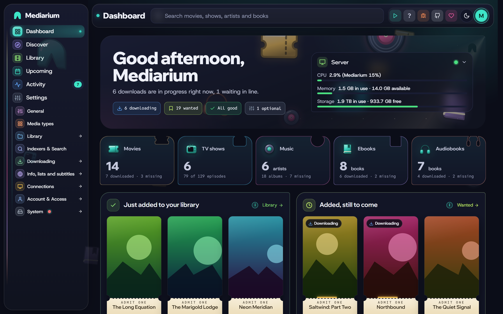
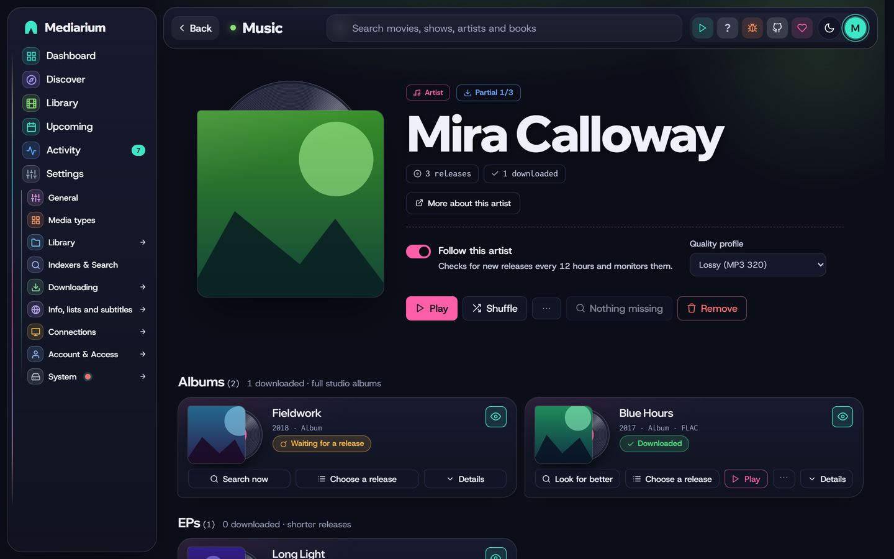
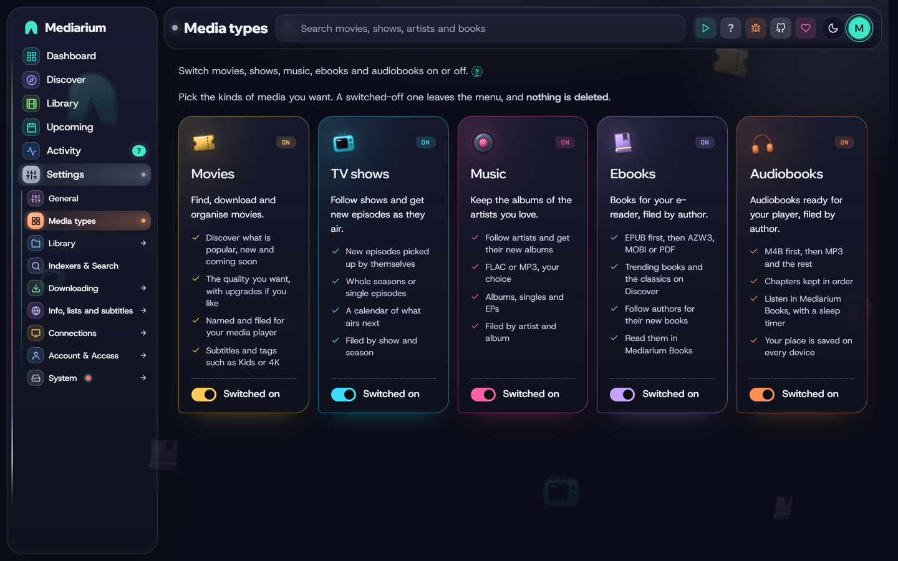
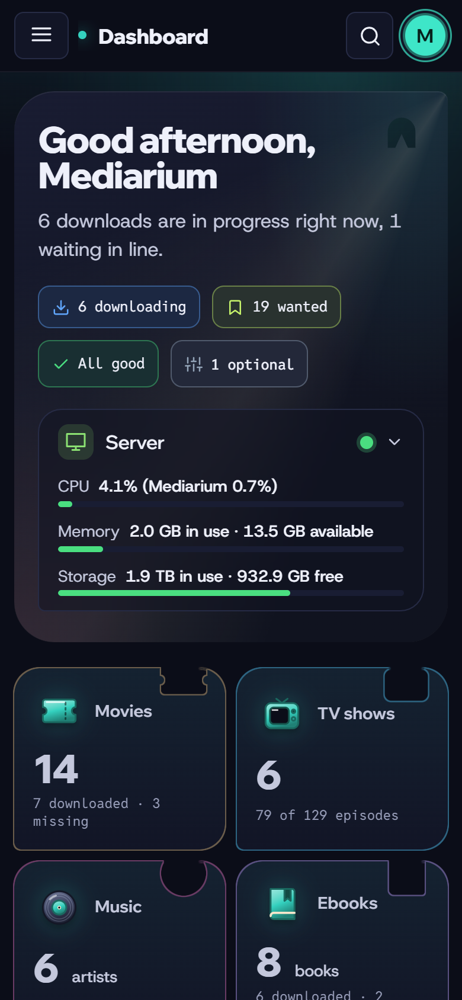

<p align="center">
  <picture>
    <source media="(prefers-color-scheme: dark)" srcset="branding/mediarium-lockup-dark.svg" />
    
  </picture>
</p>

<p align="center"><b>Your movies, TV, music and books, from search to library, in one app.</b></p>

<p align="center">
  <a href="docs/INSTALL.md">Install</a> ·
  <a href="docs/README.md">Documentation</a> ·
  <a href="docs/FEATURES.md">Features</a> ·
  <a href="CHANGELOG.md">Changelog</a> ·
  <a href="https://github.com/rdborg/Mediarium/issues">Report a bug</a> ·
  <a href="https://github.com/rdborg/Mediarium/discussions">Ideas and questions</a>
</p>

# Mediarium

Mediarium is a self-hosted media manager. Find a movie or show, and it searches your Usenet and torrent indexers, downloads the best release, unpacks it, names it and puts it in your library, ready for Plex, Jellyfin or Emby.

It does the jobs of Radarr, Sonarr, Prowlarr, SABnzbd, a torrent client and Bazarr in **one app**: one container, one web page, one search bar, one thing to update and back up.

- **Movies and TV** (anime, daily shows and specials included), plus **music**, **ebooks** and **audiobooks** if you switch them on.
- **Mediarium Books**, a built-in reader and audiobook player that opens as an app of its own and remembers your place on every device. It reads Kindle books too, jumps between audiobook chapters, and follows book series.
- **Tags** such as Kids or 4K, which also show up as collections in Plex, Jellyfin and Emby.
- **Discover and search** everything from one place, across all your indexers.
- **Built-in downloaders** for Usenet and torrents, with repair and unpacking.
- **Built-in VPN** for torrents (WireGuard), with no special container permissions.
- **Quality profiles** with upgrades and fallbacks, automatic searching and retries.
- **Family accounts with permissions and requests**: choose what each person can do, and anyone who can't add titles sends a request for you to approve.
- **Subtitles** picked to match your exact file, with a timing fix when one is out of sync.
- **What's been watched**, read from Plex, Jellyfin and Emby, with watch statistics and optional cleanup rules (all off until you switch them on).
- Notifications, media-server refresh (Plex, Jellyfin, Emby, Audiobookshelf, Kavita), download hours, backups, and your own script after each import.
- **Move over from Radarr, Sonarr, Prowlarr, SABnzbd** and eight other apps without redoing your setup. They are only read, never changed.
- Runs on **Synology, Unraid, QNAP, any Linux server** and 64-bit Raspberry Pi.

**Privacy:** there are no ads, and Mediarium sends nothing about you or your library anywhere. It asks once whether you want to share a small anonymous message a day (a random ID, the version and rough device sizes) so the project can see which devices are popular: it is off until you say Yes, the numbers are public at [mediarium.app/stats](https://mediarium.app/stats/), and the code is open. [What exactly is sent](docs/usage-stats.md).

Mediarium is new. Movies and TV work end to end, and so do music, ebooks and audiobooks once you switch them on. It's used daily, but expect some rough edges. [FEATURES.md](docs/FEATURES.md) says what works and what doesn't yet.

## Screenshots

| | |
|---|---|
|  |  |
| **Dashboard**: what needs attention, a card per kind of media and the Server card | **Discover**: more like your library, trending, popular and coming soon |
|  |  |
| **Library**: every title with its status, and Select to change many at once | **Activity**: what is downloading, waiting in line or failed, plus history and blocklist |
|  |  |
| **Upcoming**: the calendar of releases and episodes, and what is still wanted | **Music**: artists and albums, off until you switch it on |
|  |  |
| **Books**: trending and classic books, each marked eBook, Audiobook or both | **Mediarium Books**: your shelf, with the reader and the audiobook player |
|  |  |
| **Media types**: switch movies, TV, music, ebooks and audiobooks on or off | **Quality**: profiles and the fallback order |

<p align="center"></p>

> **About these screenshots.** They were taken in demo mode, so every movie, show, artist, poster and cover in them is made up (the books are old public-domain classics). That's on purpose: the pictures don't use anyone else's titles or artwork. In your own copy, Mediarium shows the real posters, artwork and details for whatever you search for and add.

## Install with Docker

Mediarium runs in Docker on any 64-bit Linux server or NAS (`amd64` or `arm64`).

```bash
mkdir mediarium && cd mediarium
curl -fsSLO https://raw.githubusercontent.com/rdborg/Mediarium/main/docker/docker-compose.yml
# open docker-compose.yml and set PUID, PGID, TZ and your folders
docker compose up -d
```

Then open `http://<your-server-ip>:8264` and follow the setup wizard.

The [install guide](docs/INSTALL.md) covers every line of [`docker-compose.yml`](docker/docker-compose.yml): folders, PUID/PGID, why one `/data` folder makes imports instant, updating, backups and a `docker run` alternative.

Step-by-step guides: **[Synology](docs/synology.md)** (including running next to Radarr, Sonarr and SABnzbd) · **[Unraid](docs/unraid.md)** · **[QNAP](docs/qnap.md)** · **[Linux](docs/linux.md)**. Coming from the *arr apps? See [Move from Radarr, Sonarr, Prowlarr and SABnzbd](docs/migrate.md).

### One image for every platform

Mediarium comes as one Docker image, and everything that can run Docker runs the same image with the same settings. There is no separate build or app-store version to wait for.

| Platform | How |
|---|---|
| Any 64-bit Linux server, NAS or Raspberry Pi (Intel/AMD or ARM64) | Docker Compose, or one `docker run` command (the image is on GitHub and on Docker Hub as `rdborg/mediarium`) |
| Synology, QNAP, Unraid, TrueNAS SCALE, CasaOS/ZimaOS, OpenMediaVault, Portainer | Paste the same compose file into their Docker screen: [guides](docs/PLATFORMS.md) |
| Windows PC or Mac | Docker Desktop, fine for trying it out |

There are no one-click app-store entries for now, and no separate Windows or macOS versions.

Details: [What runs where](docs/PLATFORMS.md).

## Documentation

Everything is in [`docs/`](docs/README.md): installing, indexers, downloads and the torrent port, quality profiles, subtitles, media servers, family accounts, and reference pages for the API, environment variables and settings.

## Getting help

- **Something not working?** Check [troubleshooting](docs/INSTALL.md#troubleshooting), then [open an issue](https://github.com/rdborg/Mediarium/issues/new/choose). Include your version (Settings > System > About and credits), or better, the text that **Copy for support** puts on your clipboard (Settings > System > Server and updates > Help and support). It has no passwords or keys in it.
- **Security problem?** Report it privately, as described in [SECURITY.md](.github/SECURITY.md).
- **Ideas and feature requests** are welcome as [issues](https://github.com/rdborg/Mediarium/issues/new/choose).

## Support the project

Mediarium is free, open source and has no ads. If it saves you time, you can [buy a coffee on Ko-fi](https://ko-fi.com/ryanborg). The app works exactly the same either way.

## Contributing

Contributions are welcome. Start with [CONTRIBUTING.md](.github/CONTRIBUTING.md) and follow the [Code of Conduct](.github/CODE_OF_CONDUCT.md).

## Responsible use

Mediarium does not host, provide or link to any content. It is a tool for managing media you have the right to access. You are responsible for the indexers you add and what you download: read [LEGAL.md](docs/LEGAL.md).

## Licence

Mediarium is free software under the [GNU Affero General Public License v3.0](LICENSE) (AGPL-3.0). You can use it, change it and share it. If you offer a changed version to others as a network service, you must share your source code under the same licence.

### The name and logo

The licence covers the code, not the name. "Mediarium" and the Mediarium logo are the names I use for this project. You're welcome to fork it, change it and share your version under the AGPL, but if you share a changed version, please give it a different name and logo so people can tell it apart from this one. Saying it's based on Mediarium is fine, and appreciated.
