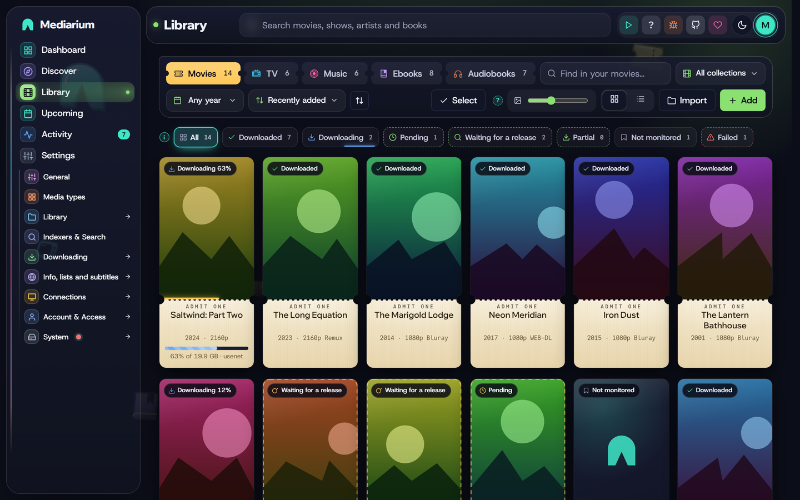

# The Library page

The Library shows what's in your library: a tab each for **Movies**, **TV**, **Music**, **Ebooks** and **Audiobooks** (only the kinds that are switched on, see [modules.md](./modules.md)). Every title is a poster or a row, with a status, and the things you do most are one click away: search for a release now, monitor or stop monitoring, open the page, and (for administrators) remove it. Above the list you can search by name, filter by genre, decade and status, and sort. The list is sorted by **Recently added**, newest first, until you pick another sort. While the Movies or TV tab is still empty, a row of popular titles underneath gives you something to add straight away. The book tabs are described in [books.md](./books.md). To keep kids' films, 4K or anything else apart, use tags (below) rather than separate folders.

*The Library, Movies tab.*

To do the same thing to many titles at once, use **Select**.

## Finding your way

- **Status words.** Each title says where it is: **Downloaded**, **Downloading**, **Pending** (waiting its turn in the download line), **Waiting for a release** (monitored, and Mediarium checks regularly for one), **Partial** (some episodes are downloaded), **Not monitored** (in your library, but nothing is downloaded on its own) and **Failed**. The chips under the toolbar filter by these words and show how many titles each holds.
- **Back brings the list back as it was.** The tab, the status chip, the search text, the genre, tag and decade live in the address (for example `/library?kind=tv&st=pending`), so pressing Back from a title returns to the same list with the same filters. Discover works the same way for its tab and filters.
- **The Downloading chip** only shows its moving blue line while something is really downloading.
- **Clear filters.** When a search, chip, genre or year is narrowing the list, a **Clear filters** button appears beside the chips, and in the "Nothing matches these filters" message when nothing is left. It puts them all back.
- **Ended shows.** A show that has finished (TMDB says Ended or Canceled) has a red **Ended** ribbon on its poster, and its page says **Ended**, **Continuing** or **Upcoming** next to the episode count. A show shows no status until it has been refreshed once.
- **Sort.** **Recently added**, **Title A–Z** (without a leading "The", "A" or "An", so The Matrix is under M), **Newest release** (release date, or the date a show started), **Largest on disk** (the movie's file, or all of a show's downloaded episodes) and **Status**.
- **Sort direction.** The button with the up-and-down arrows next to **Sort** reverses the order (oldest first, Z to A, smallest first). The sort and its direction are remembered in this browser.
- **Poster size.** In the grid, the slider next to the grid and list buttons makes the posters bigger or smaller. It is remembered in this browser (and hidden on small screens).
- **Press `/`** anywhere (except while you type in a box) to jump to the search box at the top, and **Esc** to leave it.

## Looking at the files on your disk again

If you delete or rename files outside Mediarium, its list doesn't know until you tell it. **Rescan files** (on a show's page, and on a movie's page) looks at every downloaded file of that title: a file that is still there is fine, a file that was renamed (for example `.mp4` to `.mkv`) is found under its new name, and a file that is gone makes its episode or movie **wanted** again. The media servers are asked to scan the folder afterwards. Administrators only.

A rescan won't believe that everything is gone when the library folder itself is empty or missing (a drive that isn't plugged in): those files are left alone and the message says so. The same goes for a file it can't check (the disk gives an error, or two files with the same name and different extensions are there): it is skipped, never marked missing. **Refresh episodes** is a different thing: it only reloads the episode list from TMDB. Scripts: `POST /api/movies/{id}/rescan` and `POST /api/series/{id}/rescan` answer with `found`, `renamed`, `missing` and `skipped`.

## Finding the missing episodes of one season

A show with many seasons doesn't have to be searched all at once. **Find missing** in a season's header searches your indexers right now for that season's missing episodes only, and downloads what it finds. The rest of the show is left alone, and the search keeps to the same indexer limits and pacing as any other search. **Find missing episodes** at the top of the show page does the whole show. Scripts: `POST /api/series/{id}/search-now` with `{"season": 2}`.

## Deleting a file and keeping the title

To get a better or smaller version of something you already have, delete the file and let Mediarium look again, without removing the title:

- **A movie:** **Delete file** on its page.
- **One episode:** **Delete file** on the episode's row (open the season first).
- **A whole season:** **Delete files** in the season's header.

Administrators only. The files (and the subtitles and artwork named after them) go to the recycle bin, or are deleted if the bin is switched off (Settings > System, in the clean-up card). The movie or the episodes become **wanted** again, and stay monitored if they were, so the next search can fill them. A file that holds two episodes is deleted once and both come back as wanted. Nothing outside your library folders is ever touched. Scripts: `DELETE /api/movies/{id}/file`, `DELETE /api/episodes/{id}/file` and `DELETE /api/series/{id}/seasons/{season}/files` (each answers with how many files went and how many episodes are wanted again; `409` when there's nothing downloaded to delete).

A season pack you pick yourself for a season that is fully downloaded is no longer refused with "no episodes to fill": it goes through **If a file already exists** like any import. With the default, it replaces a file only when the pack is a better quality and the show may be upgraded. To replace worse or equal files, set **If a file already exists** to overwrite, or delete the season's files first.

## Selecting many titles

**Select** is for administrators. Members see the Library without it.

*Five movies selected. The bar stays in view while you scroll.*

1. Press **Select** in the toolbar. A tick circle appears on every poster and a tick box on every row of the list view.
2. Tick titles by clicking them. Hold **Shift** and click to tick everything between the last one you ticked and this one. In the list view the box in the header ticks everything in the view.
3. The bar at the top of the page stays in view while you scroll. It says how many are selected ("12 selected") and has:
   - **Select all N in this view** and **Select none**. "This view" is what's showing after your search, genre, year and status filters. The Library isn't split into pages, so that's all of them at once. A line beside the buttons says what that reaches: "Everything in your library is in this view (64 movies)." or, with a filter on, "Filters are on: this view has 7 of the 300 shows in your library."
   - The actions below.
   - **Done**, which leaves select mode and clears the ticks.

Actions only reach titles you can see. If you tick ten titles and then type in the search box, the bar counts, and the actions change, only the ticked titles that still match. Clear the search and the others are still ticked.

On a phone the bar takes one row and the actions fold away behind an **Actions** button.

## What you can do to the selection

| Action | What it does |
|---|---|
| **Monitor** / **Stop monitoring** | Turns automatic searching on or off. Stopping also removes downloads that were only waiting for these titles. |
| **Better versions** | **Look for better versions** lets Mediarium swap a download for a better one, if the title's quality profile allows upgrades. **Leave what I have alone** stops that for these titles, whatever their profile says, and removes waiting downloads that would have replaced a file. |
| **Quality profile** | Gives them a profile, or the default. |
| **Download from** | Usenet only, torrents only, both, or the choice in Settings. |
| **Move to folder** | Appears once you have more than one movie or TV folder. Sends the next files of the selected titles to the folder you pick, or moves the files that are already there as well. See [Moving titles to another folder](#moving-titles-to-another-folder). |
| **Search now** | Looks for releases of the selected titles that are **monitored and missing something**. A confirmation says how many will be searched, for example "42 of the 64 selected are monitored and missing something". At most **25 titles** are searched per press, and the rest are left to the automatic search. The search runs in the background, one title after another, and the result is written to Activity ("Searched for 25 titles and started 3 downloads."). Only one such search runs at a time. Movies that aren't out yet are skipped. |
| **Replace with smaller** | Movies tab only. For movies you gave a lower quality profile: looks for a smaller release that the profile accepts, downloads it, and only then removes the big file. A confirmation names the titles and how much space their files take. At most **25 movies** per press, one after another in the background, with the result in Activity. A file that has no suitable replacement stays. See [Moving a title to a lower profile](quality-profiles.md#moving-a-title-to-a-lower-profile). |
| **Remove from library** | Takes them out of the library. See below. |

Every action says how it went. When all went well you get a short message such as **Done: 12 updated.** If some couldn't be done, a note stays on the page with the reason for each ("Alpha: It isn't in your library any more.") until you dismiss it, and the message says how many worked: "Done: 10 updated. 2 titles could not be changed."

### Removing many titles

Removing shows a question with the names of the titles and the number. Downloads running for them are cancelled and their working files in the downloads folder are deleted, whatever you choose.

**Files in your library are only deleted if you tick "Also delete the files of all N from the disk".** That goes for one title or many. When you remove a single title, the box shows how many files and how much space they take in your library (for example "3 files, 11.0 GB"). They go to the recycle bin first (**Activity > Recycle bin**) and are deleted for good after 7 days, so a slip can be undone with **Put back** (see [Removing a movie or show](downloads.md#the-recycle-bin)). When you tick it, a red line repeats how many titles are affected. A title whose files lie outside your library folder is never touched. It's left in place, and the note says why. The others carry on.

Every removal writes a line to **Activity** that says what happened to the files, for one title and for many alike: "Night Harbour removed from library. Its files were deleted (4 files, 1 folder)." or "Night Harbour removed from library. Its files were kept (1 file)." A title with no file on disk says "It had no files on disk."

## Tags

Tags are your own words for sorting a library that lives in one folder: **Kids**, **4K**, **Christmas**, **Dad's films**, anything. They are the way to keep kids' films or 4K copies apart without separate folders.

- **On a title's page**, under the controls: type a tag and press Enter (or a comma). Tags already in use are suggested as you type. Press × on a tag to take it off.
- **When adding** a movie or show, the add window has a **Tags** box, so a title can be tagged Kids from the start.
- **On many titles at once**: in **Select** mode, **Tags** adds a tag to every chosen title, or removes one of the tags they have.
- **Filter by tag**: the Library's **Tag** filter (shown once a tag is in use) lists only the titles with that tag. Cards show their tags under the title.
- Up to 20 tags per title, 30 characters each. Case doesn't matter: "kids" joins an existing "Kids".
- **On your media server** every tag becomes a collection of the same name: in Plex the title's collection field, in Jellyfin and Emby a collection (box set) named after the tag. So a "Kids" tag gives a Kids collection to browse, or to share with a child's account. A title that isn't on the server yet gets its tags a few minutes after it's downloaded. Taking a tag off takes the title out of that collection. Collections you made yourself on the server are never touched. See [media-servers.md](./media-servers.md#tags-as-collections).
- Tags live in Mediarium's database and go when the title is removed.

## Anime and daily shows

Most TV releases name episodes by season (`Show.S02E05`). Two kinds of show don't:

- **Anime** counts episodes from the very first one: `[Group] Long Voyage - 1085 (1080p)`, `Show E105`, or a batch `Show - 01-12`.
- **Daily shows** (talk shows, news) go by the day: `The.Evening.Desk.2024.03.15`.

A show's page has **Episode numbering**: *Seasons (S01E05)*, *Anime (episode 105)* or *Daily (by air date)*. Mediarium sets it when the show is added, also when it comes from a library import or from Sonarr, which passes on its own setting (Japanese animation is Anime; talk shows and news are Daily), and you can change it. Later anime seasons named like "Show S2 - 05" are read as that season's episode, and a recap such as "Show - 12.5" is not taken for episode 12. For an Anime show, episode 105 is found by counting the show's episodes season by season from the first one (specials left out); for a Daily show, by matching the air date. Searches then also look for "Show 105" or "Show 2024 03 15", and releases and downloaded files named that way are matched to the right episode. A release that does carry a season marker is always taken as it says.

Some daily shows air two episodes on the same day. Then the words after the date pick the episode: `Show.2024.05.13.Mara.Quinn.1080p` goes to the episode whose title names Mara Quinn, and `Part 2` or `Pt2` to the second episode of that day. When the name gives nothing to tell them apart, the release is left unmatched rather than filling the wrong episode; use Choose a release on the episode for those.

The counting follows TMDB's seasons. When a show's seasons on TMDB are split differently from how a fansub group counts, an episode can come out a few places off; Choose a release on the episode always works as a fallback. Scripts: `seriesType` on a show, and `PUT /api/series/{id}/type` with `{"type": "standard" | "anime" | "daily"}`.

### Scene and anime numbering

Release names don't always count a show's episodes the way TMDB does. Scene releases follow TheXEM's numbering, so a show TMDB calls `S02E01` can be released as `S01E21`. Anime groups count from the first episode of a season or of a part of one: `[Group] Long Voyage Season 3 Part 2 - 05` is the fifth episode of that part, which is episode 17 of season 3 on TMDB. Mediarium reads how a show is numbered from three free services and uses it to match release names, to search under the names releases use, and to import downloaded files:

- **TheXEM** ([thexem.info](https://thexem.info)) lists, for shows that have scene numbering, which episode each scene season, episode and absolute number stands for. Sonarr uses the same data.
- **The anime lists** ([Fribb/anime-lists](https://github.com/Fribb/anime-lists), built from the Anime-Lists project and the anime-offline-database) pair every AniDB entry of an anime with its AniList and MyAnimeList ids, the TMDB season it sits in and where its episode 1 falls in that season.
- **AniList** ([anilist.co](https://anilist.co)) gives each entry's names: the romaji title, the English one and the synonyms.

A show's page shows what was found in the **Anime numbering and links** card (**Scene numbering** on a show that isn't an anime): links to the show's AniList, AniDB and MyAnimeList pages, what TheXEM has, the entries in the anime lists with the season each sits in and which episode of that season its first episode is, and the other names the show goes by. **Refresh mapping** reads it all again.

What it changes:

- A name with a season and episodes is read as scene numbering when TheXEM has those episodes. The name is mapped only when every episode in it is found, and a scene season pack only when the whole scene season is one season of the show. Anything TheXEM doesn't list stays as the name says.
- A name that ends its title with a number, `Show Season 3 Part 2 - 05`, goes to the entry its title names (a title that two entries share names neither), but only when that episode exists in the show: episode 11 of a part with ten episodes is not made up.
- A bare number, `Show - 14`, is looked up by the scene absolute number or by the show's own absolute number, when that names exactly one episode; otherwise it is counted from the show's first episode, as before.
- The show's other names count as the show's name when a release is matched to it, so `[Group] Shingeki no Kyojin - 05` is taken for *Attack on Titan*. A name with no Latin letters is never matched.
- Searches add the names releases use: the scene numbering (`Show S01E21`), the entry's name with the number inside the entry (`Show Season 3 Part 2 05`), and the first alias with the absolute number. At most four extra searches are added for an episode.

When it runs: when an anime is added or refreshed, and again after a week, Mediarium reads the numbering of shows whose type is **Anime**, and when a show's type is changed to Anime. Shows of other types aren't looked up until you press **Refresh mapping** on their page (then the mapping applies to them too). Switch the automatic lookups off with **Look up how anime and scene releases number their episodes** under **Settings > Info, lists and subtitles > Movie and show info**; what was found stays and the button still works. Nothing changes for a show until a lookup finds something.

Being polite to the services: requests to each service are at least a second apart (two seconds for AniList), TheXEM's list of mapped shows is kept for a week and only shows on it are asked about, the anime list (about 6 MB) is saved in the config folder and, once it is a day old, checked with an ETag (a press of the button checks at once), AniList is asked once per show with all its entries at once and the names are kept for a month, and every request says it is Mediarium. When a service can't be reached, what was found before is kept, the card says so in plain words, and it is tried again the next day; nothing else in the app waits for it.

Limits: the services follow TheTVDB's numbering for scene episodes, which matches TMDB for nearly every show but not all. A show whose TMDB seasons are split differently from TheTVDB's can still come out a few episodes off for scene names; **Choose a release** on the episode always works. An anime entry that the lists have no TMDB season for (a long show kept as one entry) gives ids and names but doesn't number episodes. A scene mapping reads a release as scene numbered first, so a release that really uses the show's own numbering for an episode TheXEM also lists under another number is taken as scene; that is how Sonarr behaves too.

Scripts: `GET /api/series/{id}/numbering` answers with `anilist`, `anidb`, `mal` and their `...Url` links, `sceneState` (`mapped`, `none`, `offline` or empty when never looked up), `sceneRows`, `sceneDiffers`, `listsState`, `entries` (`anidb`, `anilist`, `mal`, `type`, `season`, `offset`, `name`), `names`, `note` and `checkedAt`. `POST /api/series/{id}/numbering/refresh` reads it again now (accounts with the Manage permission). The setting is `numbering.lookup` (`numberingLookup` in `GET`/`PUT /api/settings`).

## Specials

A show's specials (TMDB's season 0: behind-the-scenes episodes, Christmas specials, OVAs) are listed on its page as **Specials**, below the other seasons. They start **unmonitored** and don't count towards how much of the show you have until you ask for them. Switching a whole show on or off, or searching the whole show, leaves them alone. Shows already in your library pick up their specials at the next refresh.

To get a special, tick its box: from then on it's looked for like any other episode. **Search** on a special looks for it straight away, ticked or not. Specials are looked for one at a time, never as a pack, and in two ways:

- **By number**, `Show S00E05`, the way most TV releases name them.
- **By title**, `Show The Winter Visitor`, because many are posted under their own name with no number at all. A release counts as the special when every telling word of the special's title comes after the show's name (the show's own words and little words like "the" or "special" don't count). A one-word title has to be at least six letters long, so a release isn't taken for a special by chance. When two specials fit equally well, the one whose whole title appears in order wins; otherwise the release is left alone. A dated release counts when exactly one special aired that day.

A downloaded special goes in the show's `Season 00` folder as `Show - S00E05 - Title`, which Plex, Jellyfin, Emby and Kodi all read as a special. Scripts: `GET /api/series/{id}/search?season=0&episode=5` searches for one special; `POST /api/series/{id}/search-now` with `{"season": 0, "episode": 5}` grabs it, and with `{"season": 0}` grabs every monitored special that's missing.

## Second copies (two qualities of one title)

A movie or show can be kept twice, in two qualities: a 4K copy for the big screen next to the 1080p one for phones and laptops, for example. It's off until you choose where second copies go.

1. Under **Settings > Library > Folders**, fill in **Folder for second copies of movies** and/or **of shows**, for example `/movies-4k` and `/tv-4k`. It has to be a folder of its own, not the movies or TV folder or one inside it, so a copy can never land on the main file. In Docker, map it like the other folders. Add it to Plex, Jellyfin or Emby as its own library.
2. On a movie's or show's page, **Second copies** has **Add a second copy**: pick the quality profile it should follow (4K & over is offered first) and press the button. Mediarium starts looking for it straight away.

A second copy is a title of its own that happens to share the main one's details:

- It follows its own quality profile, is looked for and upgraded on its own, and has its own downloads. Upgrades, fallbacks and "better versions" work as on any title.
- A movie's copy gets one file in the copies folder, named the same way as the main one. A show's copy gets the same episodes as the main show, monitored as they are on the main show, and new episodes arrive in both. Its page (**Open** in the Second copies box) has a note pointing back to the main show.
- The Library lists the title once, with "+1 copy" under its poster. The Wanted list and Activity show copies as "Second copy".
- **Remove** in the Second copies box deletes the copy and its files and leaves the main title alone. Removing the main title removes its copies too, with their files when you ask for the files to go.
- You can add one copy per quality profile, other than the profile the main title uses.

Scripts: `GET /api/movies/{id}/copies` and `GET /api/series/{id}/copies` list a title's copies; `POST` to the same address with `{"profileId": 4}` adds one. A copy is then a movie or show like any other, so search, grab, search-now, monitoring and `DELETE /api/movies/{id}` all work with the copy's id. The folders are the settings `library.movie_copies_path` and `library.tv_copies_path` (`movieCopiesPath` and `tvCopiesPath` in `PUT /api/settings`; an empty value switches second copies off for new titles).

## More than one folder per kind

Each kind of media has a main library folder (Settings > Library > Folders), plus the optional folders for [second copies](#second-copies-two-qualities-of-one-title). Under **More folders for other titles (optional)** on the same page you can add **more movie folders** and **more TV folders**: another drive, or a folder kept apart for kids' films, documentaries or concerts. Each movie or show is kept in one folder:

- When there is more than one folder, the Add dialog has **Keep it in**. The main folder is the default. Titles added without a choice (a Plex watchlist, an import, a request) go to the main one.
- A movie's or show's own page has the same choice, next to the quality profile (administrators). Changing it only decides where the **next** files go; files already in the library stay where they are.
- Importing, renaming, the recycle bin, the disk space checks, Statistics, the health check and the Radarr and Sonarr compatible root folder list all know about the extra folders. The folders have to be separate from each other and from the main ones, not inside one another.
- Add every folder to Plex, Jellyfin or Emby as a library of its own.
- Scripts: `moviesExtraPaths` and `tvExtraPaths` in `PUT /api/settings` (the whole list, sent as it should be saved); `rootPath` in `POST /api/movies` and `POST /api/series`; `PUT /api/movies/{id}/folder` and `PUT /api/series/{id}/folder` with `{"rootPath": "/usb/movies"}`; `GET /api/library/folders` lists what can be chosen (any account). The settings keys are `library.movies_extra_paths` and `library.tv_extra_paths`.

### Moving titles to another folder

On a title's page the folder choice only decides where the **next** files go. To change the folder of many titles at once, tick them in **Select** mode and pick **Move to folder** (it shows up once you have more than one folder; pick movies or shows, not both, since each has its own folders). You choose between two things:

- **Only use this folder for new files.** The files already in your library stay where they are. This is instant.
- **Also move the files that are already there.** Mediarium first shows what would happen: how many titles can be moved, how many files and how much space, and which titles will be left alone and why. Then you press **Move the files** and it works in the background; the progress is in the same window and the move carries on if you close it.

How the files are moved:

- A movie that has a folder of its own moves with everything in that folder (subtitles, the NFO and artwork, extras). A show moves with its whole folder. A movie that shares its folder with others only moves its video and the files named after it.
- The folder keeps its name and its place below the library folder, so `Heat (1995)` in `/movies` becomes `Heat (1995)` in `/movies2`. Nothing is renamed; use [Renaming existing files](#renaming-existing-files) for that.
- **On the same drive** a move is a rename: instant, and done completely or not at all.
- **To another drive** each file is copied, read back and compared with the original, and only then is the original removed. The copy is built next to its final place under a hidden name and only takes its real name once everything is in it, so Plex, Jellyfin or Emby never see half a movie. If the drive runs out of room, a file can't be written or you press **Stop**, the copy is deleted again and the original was never touched.
- **Nothing is overwritten.** If something with the same name is already in the new folder, that title is left exactly as it was and listed with the reason. The same goes for a title that is downloading right now, a second copy (those stay in the folder for second copies), a title whose files are not inside one of your library folders, and anything that is reached through a link.
- Mediarium saves the new places (including the subtitles it keeps track of) in one step, and only then removes the originals. If saving fails, the move is undone.
- Your media servers are told about the new place and rescan it. Add the new folder to them as a library if you haven't.
- A library file that is a hard link to a seeding torrent is moved, and the torrent's own file stays where it is. When that is a copy to another drive, it uses more space until the torrent is removed.
- Only one move runs at a time.

Scripts (administrators): `POST /api/library/bulk/folder` with `{"items": [...], "rootPath": "/movies2"}` changes only where new files go. `POST /api/library/move-files/preview` takes the same body and answers what a move would do; `POST /api/library/move-files` starts it (`202`); `GET /api/library/move-files/status` follows it and `POST /api/library/move-files/cancel` stops it.

Tags (above) still sort a library inside one folder. To see how full the disk is, the folder boxes show the free space, and Settings > System shows storage.

## Collections

Some films belong to a series on TMDB: a trilogy, a franchise. A movie's page shows the collection it is part of, with every film in it and which ones are in your library. Films you don't have are dimmed.

- **Add the whole collection** (administrators) adds the films that are missing. You choose the quality profile, the folder (when you have more than one) and whether they are monitored, and whether to start searching straight away. Films that aren't out yet are added too and wait until they are. Films you already have are left alone.
- **Also add new films in this collection** is a switch on the same card, and a tick box in the add window. It is off by default. When it is on, Mediarium looks at the collection every few hours and adds any film that joined it **after** you turned it on, with the profile and folder you chose then. The films the collection has when you switch it on are not added by this, so a film you left out on purpose stays out. A film on your Not interested list is not added. Turn the switch off to stop.
- **Library filter.** On the Movies tab a **Collection** filter lists the collections that have a film in your library and shows only those films.
- Mediarium finds out which collection a film belongs to when you add it. Films that were already in your library are looked up in the background, a batch every 20 minutes, so a big library fills in over a few hours.
- Only administrators can add collections or follow them; everyone can see them. A second copy shares the collection of its main film.

Scripts: `GET /api/collections` lists the collections that have a film in the library with the library ids of those films; `GET /api/collections/{id}` is one collection with its films and your follow choice (any account). `POST /api/collections/{id}/add` takes `{"profileId", "rootPath", "monitored", "sources", "searchNow", "tmdbIds", "follow"}` and `PUT /api/collections/{id}/follow` takes `{"follow", "profileId", "rootPath", "monitored"}` (administrators). The movie details (`GET /api/tmdb/movies/{tmdbId}`) carry `collection` when the film is in one.

## File permissions

**Settings > Library > Folders > File permissions** sets the permissions of the files and folders Mediarium creates in your library: imported movies, episodes, music and books, the folders made for them, subtitles it downloads, covers, and the [NFO and artwork files](./media-servers.md#nfo-and-artwork-files). It is useful when another app or user also needs to write there, for example `664` and `775` so your group can.

- The boxes take three octal digits, like `644` for files and `755` for folders. The preview under each box shows them the way `ls` does (`rw-r--r--`).
- **Both empty is the default** and changes nothing: new files get whatever the container's umask leaves (see `UMASK` in [INSTALL.md](./INSTALL.md#puid-pgid-and-tz)), as before.
- A mode you set is applied with `chmod` after the file or folder is made, so it does not depend on the umask. It is only applied to what Mediarium creates, never to a folder that was already there, and never to a link.
- The owner has to keep access: files need `6` or `7` in the first digit and folders `7`, or Mediarium couldn't manage what it made. Setuid, setgid and sticky bits are not supported.
- **A mode that anyone on the machine can write to** (the last digit is 2, 3, 6 or 7, like `666` or `777`) is not saved unless you tick **I understand, save it anyway**, and a warning explains why. `664` and `775` are the usual choice when a group needs to write.
- A file that is **hard linked** from your downloads folder (the usual way Mediarium imports on the same drive) is the same file in both places, so changing its mode changes it for both. A download client that seeds the file sees the new mode too. If the mode can't be set (a network share that doesn't allow it, or a file owned by someone else), a warning goes to the log and the import goes on.
- A change applies from the next file on. Files that are already there are not changed.

Scripts: `GET /api/settings/file-permissions` and `PUT /api/settings/file-permissions` with `{"fileMode": "664", "folderMode": "775", "confirmWorldWritable": false}` (administrators). The settings are `library.file_mode` and `library.folder_mode`.

## File names

**Settings > Library > File names and importing** picks how imported files are named. Plex, Jellyfin / Emby, Kodi and Simple each name movies and episodes the way that media player likes. **Custom** lets you write your own. The page shows a preview of a made-up movie and episode as you type.

With **Custom** you can:

- **Start from** a ready-made format (Plex, Jellyfin / Emby, Kodi, *Detailed, like Radarr and Sonarr*, or *Plex with editions*) and change it.
- **Paste the format you already use in Radarr or Sonarr.** Mediarium understands their token names, so `{Movie CleanTitle} ({Release Year}) - {Custom Formats}{ - Edition Tags}` works as it is.
- **Click a token** in the list next to the boxes to add it where the cursor is.

There is one box for movies and one for episodes. An episode name needs `{Season}` and `{Episode}`, also for daily shows (two episodes can air on the same day), so two episodes never get the same name. A movie name needs its title. A format you wrote while another style was picked is checked when you switch to **Custom**.

A title with no name gets a folder and file called `tmdb-` and its TMDB number, and dots or spaces at the start of a name are left out, since a name starting with a dot is hidden.

**Tokens.** Names aren't case sensitive, and `{Movie.CleanTitle}` or `{Movie_CleanTitle}` puts a dot or underscore between the words.

| Group | Tokens |
|---|---|
| Movie | `{Movie Title}`, `{Movie CleanTitle}`, `{Movie TitleThe}`, `{Movie CleanTitleThe}`, `{Movie TitleFirstCharacter}`, `{Release Year}`, `{Movie Year}`, `{Year}`, `{Edition Tags}` |
| Show and episode | `{Series Title}`, `{Series CleanTitle}`, `{Series TitleYear}`, `{Series CleanTitleYear}`, `{Series TitleThe}`, `{Season}`, `{Episode}`, `{Episode Title}`, `{Episode CleanTitle}`, `{Air-Date}` |
| Ids | `{TmdbId}`, `{ImdbId}`, `{TvdbId}` |
| Quality | `{Quality Full}` (for example `Bluray-1080p Proper`), `{Quality Title}`, `{Quality Proper}`, `{Quality}`, `{Source}` |
| Media info | `{MediaInfo Simple}`, `{MediaInfo Full}`, `{MediaInfo VideoCodec}`, `{MediaInfo AudioCodec}`, `{MediaInfo AudioLanguages}`, `{MediaInfo VideoDynamicRange}`, `{MediaInfo VideoDynamicRangeType}`, `{MediaInfo 3D}`, `{Codec}` |
| Release | `{Release Group}`, `{Custom Formats}` |

**Text around a token.** Anything inside the braces next to the token name is only written when the token has a value. `{ - Edition Tags}` adds " - Extended" for an extended cut and nothing otherwise; `{[Quality Full]}` adds the brackets only with a quality. For Plex's edition tag, `{edition-{Edition Tags}}` gives `{edition-Extended}`.

**Numbers.** `{Season:00}` pads to two digits (`S01`), `{Episode:000}` to three.

**What Mediarium doesn't know yet.** The media info comes from the release name, not from reading the file, so audio channels, bit depth and subtitle languages are left out (those tokens are accepted and write nothing). Mediarium doesn't have custom formats yet, so `{Custom Formats}` holds the edition; when the format also has `{Edition Tags}`, the edition is written once. `{Preferred Words}` is accepted and writes nothing.

Scripts: `GET /api/settings/naming-tokens` lists the tokens and ready-made formats, and `GET /api/settings/naming-preview?kind=movie|tv&format=...` returns the preview and, for a format with a mistake, what's wrong in `problem`. The formats are saved as `movieNameFormat` and `episodeNameFormat` with `PUT /api/settings`.

## Renaming existing files

Files keep the name they had when they arrived. After you change the naming preset (Settings > Library > File names and importing), **Rename existing files** on the same page lists every movie and episode whose name would change, as "old name → new name". Untick any you want to leave alone and press **Rename**. Subtitles, `.nfo` and artwork named after a video move with it, empty folders left behind are removed, and your media server is told. A file is never moved outside the library folder or onto another file; those are listed as not renamed. Scripts: `GET /api/rename?kind=movie|tv` (the preview) and `POST /api/rename` with `{"items": [{"kind": "movie", "id": 12}]}`.

## Statistics

**See statistics** under the dashboard's cards, or **Settings > System > Statistics**, opens the Statistics page (`/settings/statistics`; the old `/stats` address still lands there): how many movies, shows, episodes and albums you have and how many are downloaded, how much space the library takes, the number of titles at each quality (with their size), and how many downloads finished or failed each month, with how much came from Usenet. The months go back as far as the history is kept (90 days unless changed). Scripts: `GET /api/stats/library`.

**Over time** shows how the library grew: its size, the number of movies and shows, and the downloads that finished each week, for the last 3 months, a year or everything. Hover over a chart (or touch it) to read a day's value; **Show as a table** lists the numbers. Mediarium writes down one small snapshot of the library a day, kept for good, so these charts go back further than the download history. Days before the first snapshot are filled in from when titles were added and from the download history that's still kept; the library's size is only known from the first snapshot on. Scripts: `GET /api/stats/history` (`?days=90` for the last 90 days).

With **What's been watched** on (Settings > Media servers, see [media-servers.md](./media-servers.md#whats-been-watched)), the page also has **What gets watched**: how many of the movies and episodes you have were played, how much space the never-played ones take, the most watched titles and the ones watched lately. It counts what your media servers last said, so it is as fresh as the last read.

## Music

The Music tab has the same **Select** mode for artists, with **Follow**, **Stop following**, **Quality profile** (the music profiles) and **Remove from library**. Removing asks the same way and keeps the album folders unless you tick the box.

## For scripts

Tags: `GET /api/tags` lists them with how many movies and shows have each; `PUT /api/movies/{id}/tags` and `PUT /api/series/{id}/tags` take `{"tags": ["Kids", "4K"]}` and replace the title's tags; `PUT /api/library/bulk/tags` takes `{"items": [...], "add": [...], "remove": [...]}` (administrators). Movies and shows carry `"tags"` in their JSON.

All of these are for administrators. A title is `{"kind": "movie" | "tv", "id": n}`. Each request changes all its titles in one database transaction, so a failure part way changes nothing. A title that's not in the library (any more) is skipped and reported, and the rest are changed. Up to 5000 titles per request.

| Request | Body | Notes |
|---|---|---|
| `PUT /api/library/bulk/monitored` | `{items, monitored}` | |
| `PUT /api/library/bulk/no-upgrade` | `{items, noUpgrade}` | `true` leaves the titles alone; `false` looks for better versions again |
| `PUT /api/library/bulk/profile` | `{items, profileId}` | `0` is the default profile; an unknown profile is refused (`400`) and nothing changes |
| `PUT /api/library/bulk/sources` | `{items, sources}` | `""` (default), `usenet`, `torrent` or `both` |
| `POST /api/library/bulk/search-now` | `{items}` | answers `202` at once; `{searching, leftOut, limit, skipped, failed, message}` |
| `POST /api/library/bulk/remove` | `{items, deleteFiles}` | `deleteFiles` is `false` when left out |
| `PUT /api/music/bulk/follow` | `{ids, monitored}` | artists |
| `PUT /api/music/bulk/profile` | `{ids, profileId}` | artists; `0` is the default music profile |
| `POST /api/music/bulk/remove` | `{ids, deleteFiles}` | artists |

Every answer except search-now is `{updated, failed: [{kind, id, title?, reason}], message}`.

## Big lists

`GET /api/movies` and `GET /api/series` are the two biggest answers, and the Library page asks for them every few seconds. They're sent compressed (gzip) when the client accepts it, and carry an `ETag`. A client that sends it back in `If-None-Match` gets `304 Not Modified` with no body while nothing has changed. These two answers are marked `Cache-Control: private, no-cache` (the browser may keep a copy but has to ask first). The books, artists, Wanted, calendar, dashboard, Activity and download lists work the same way. Every other answer in the API is `no-store`.

Add `?brief=1` to `GET /api/movies`, `GET /api/series` and `GET /api/books` to leave out each title's `overview` (a book's `description`). That is most of the answer for a big library, and the Library page doesn't need it. Without it the answers are as they were. `GET /api/queue?active=1` lists only the downloads that are waiting, downloading or importing, which is what the number next to Activity in the menu counts.

The Library page itself only draws the posters (or rows) near the screen, however long the list is, so a library of thousands of titles opens quickly and scrolls the same as a short one. Select all, search and the filters still work on the whole list.

The interactive release lists (`GET /api/movies/{id}/search`, `GET /api/series/{id}/search` and `POST /api/music/albums/{id}/search`) answer with a plain list. With `?detail=1` they answer `{results, sources, unanswered: [{name, message}]}`, which also says how many indexers were asked and which of them didn't answer.
