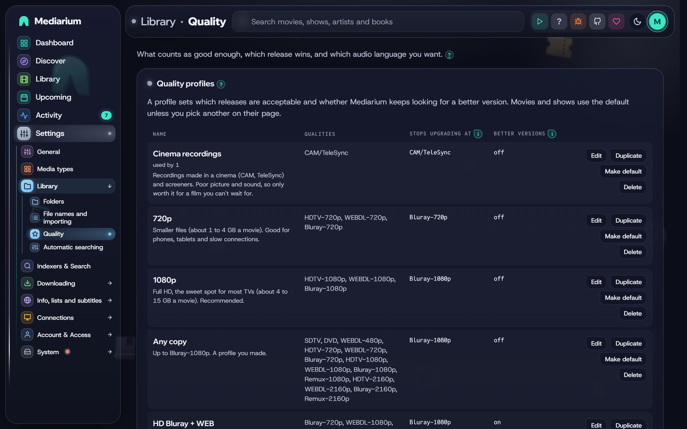

# Quality profiles

A quality profile decides which releases Mediarium may download for a movie or show, and when it stops looking for something better. Every title uses the **default profile** unless you give it one of its own. Change the default with **Make default for movies** on Settings > Library > Quality (or `PUT /api/settings` with `defaultProfileId`), and a single title's profile from its page.

Shows can have a default of their own. Press **Make default for TV** on a profile (or send `defaultTvProfileId` in `PUT /api/settings`) and every show with no profile of its own uses that one, while movies keep the movie default. Until you set one, shows use the same default as movies, so nothing changes for you. **Use the movie default for TV** (or `defaultTvProfileId: 0`) puts it back. The add-title window, a title's profile picker and the Library list all show the default that fits the title. A profile that is the default for movies or for TV can't be deleted.

A profile has:

- **Accepted qualities**: the quality tiers it accepts, such as `WEBDL-1080p` or `Bluray-2160p`. A release in any other tier is skipped.
- **Stop upgrading once this quality is reached** (the *cutoff*): once a title has a file at or above this tier, Mediarium stops searching for upgrades.
- **Keep looking for better versions after it is downloaded** (shown as *Better versions* in the list, `upgradeAllowed` in the API): a title with a file below the cutoff keeps being searched for a better allowed release. Left off, the first acceptable release is kept. A new profile starts with it off.
- Optional **Release restrictions & preferred terms**: words a release name must contain at least one of, words it must not contain any of, and preferred words with a score. One term per line, matched anywhere in the release name, ignoring capitals, with dots and dashes counting as spaces.
- Optional fallback profiles (**If nothing is found at this quality, also try**): other profiles to try, in order, when nothing found is acceptable to this one (see below).
- **Skip bad releases** (`skipBadReleases`), on unless you switch it off: leaves out releases nobody wants to watch at home, so you get good downloads without any extra setup. These are whole Blu-ray discs (BDMV, BD50, "COMPLETE BLURAY"), 3D releases (SBS, OU, MVC), upscaled copies, subtitles burned into the picture (HC, HARDSUB, KORSUB) and groups known for poor re-encodes (YIFY/YTS, aXXo and a few others). Between two releases of the same quality it also prefers a group's fixed release (PROPER, REPACK). A release left out says why in interactive search, for example "is a 3D release, which "Skip bad releases" leaves out", and you can still grab it by hand.
- **Never download season packs** (`noSeasonPacks`): whole-season releases are skipped, so TV episodes are fetched one by one even when a full season is out. Off by default.
- Optional **Custom format scores**: a score for each custom format, a minimum score and an upgrade-until score (see [Custom formats](#custom-formats) below). They're hidden until you switch on **Show advanced options**.



*Settings > Library > Quality: the profiles come first, each with its qualities, where it stops upgrading, and Edit, Make default and Delete. The default profile's fallback order sits below the list.*


*Edit on a profile opens this form above the list.*

## Moving a title to a lower profile

Giving a title a lower profile (say 4K down to 1080p) changes what Mediarium accepts from now on. It does not touch the file you already have, and it never searches for a smaller one by itself: a 4K file on a 1080p profile counts as above the cutoff, so it is simply left alone. This is the same as in Radarr and Sonarr.

To shrink a movie you already have, use **Replace with a smaller version** on its page (or on a selection in the Library, see [Selecting many titles](library.md#selecting-many-titles)):

1. Give the movie the profile you want, for example 1080p.
2. Press **Replace with a smaller version**. A question names the file you have and its size.
3. Mediarium searches your indexers for the best release that the movie's current profile accepts, that is not a higher quality than your file, and that is at least a tenth smaller. If it finds one it downloads it like any other release.
4. Only when the new file is downloaded and in your library is the old file removed. If nothing suitable is found, or the download fails, your old file stays and the movie stays downloaded. Nothing is deleted first.

The new file goes through the usual import, so **If a file already exists** (Settings > Library > Folders) is respected for the name of the new file. If the movie's file changed while the download was running, nothing is removed. For TV shows there is no such button yet: change the profile and the episodes that are already below it are looked for again, but a file above the profile is left alone.

The same thing through the API: `POST /api/movies/{id}/replace-smaller` for one movie, and `POST /api/library/bulk/replace-smaller` with `{"items": [{"kind": "movie", "id": 1}]}` for a selection (administrators, at most 25 at a time).

## The built-in presets

Mediarium comes with five presets, loosely based on the [TRaSH Guides](https://trash-guides.info/) recommendations. All five start with better versions off, so a title is downloaded once and then left alone. The cutoff in the table is where a profile stops if you switch better versions on. They're listed from lowest to best, with Any last.

| Preset | Allowed qualities | Cutoff | Good for |
|---|---|---|---|
| **Cinema recordings** | CAM/TeleSync only | CAM/TeleSync | a film that is still only in cinemas |
| **720p** | HDTV-720p, WEBDL-720p, Bluray-720p | Bluray-720p | small screens, little storage or slow connections |
| **1080p** (default) | HDTV-1080p, WEBDL-1080p, Bluray-1080p | Bluray-1080p | most people |
| **4K & over** | WEBDL-2160p, Bluray-2160p, Remux-2160p | Bluray-2160p | 4K screens with plenty of storage |
| **Any** | every recognised tier, from SDTV and DVD up to Remux-2160p | Bluray-1080p | getting *something* for rare or old titles |

Good to know:

- **Each resolution preset takes only its own resolution.** 1080p never settles for 720p and 4K & over never settles for 1080p. A title with no release at that resolution waits until one appears. Use **Any** (or your own profile) for titles that may never get one.
- **1080p** doesn't include **Remux-1080p**. A remux is an untouched copy of the disc, often 20 to 40 GB per movie, several times the size of a Bluray encode that looks the same on most screens. For remuxes, make your own profile.
- **4K & over** has a Bluray-2160p cutoff, so a 4K remux is downloaded only when it's the best release found, not hunted as an upgrade.
- **Any** stops upgrading at Bluray-1080p, so a title isn't chased all the way to a 4K remux. Releases whose name carries no recognisable quality aren't accepted.
- **Cinema recordings and screeners** (CAM, HDCAM, TeleSync/TS/HDTS, Telecine/TC, screeners, R5, and the same with Rip on the end, like HDCAMRip or HDTSRip) are their own quality, **CAM/TeleSync**, even when the name also says 1080p. Only the **Cinema recordings** preset accepts them, and it accepts nothing else, so a new film with only such copies waits for a proper release. Because some cinema recordings are named like a normal WEB-DL, Mediarium also doesn't search for a film automatically while it is only in cinemas: it waits for the digital or disc date TMDB lists, or 90 days after the cinema date when there is none (the title's history says which). Films from before the last five months aren't affected, a profile that ticks CAM/TeleSync isn't held, and **Search now** or picking a release by hand always works. In the release list of a film that is still before its digital or disc release, every release gets the note that it may be a recording made in a cinema even though its name says WEB-DL (a name can't be trusted before that date). Tick CAM/TeleSync in your own profile if you want them.
- **Cinema recordings** works best as a fallback (see below). A film that's still only in cinemas gets a recording now, and a proper release replaces it as soon as one appears.

The presets are ordinary profiles. Edit, rename or delete them (except the current default), or make your own from scratch.

**Changing a title's profile to a higher one.** When a movie's or show's file isn't one of the new profile's qualities and sits below its cutoff (a 1080p movie put on **4K & over**), Mediarium takes that as "I want this quality": it switches on looking for better versions for that title and searches straight away, even when the profile itself has better versions off. The page says it's searching. This also happens when you change the profile of many titles at once from the Library. A file that is better than the new profile (a 4K file put on 1080p) is kept; nothing is swapped for a worse release. `PUT /api/movies/{id}/profile` and `PUT /api/series/{id}/profile` answer `{"searching": true}` when a search started.

**Edit** opens the form right under the profile you pressed it on, scrolls it into view and puts the cursor in the name. **New profile** opens the form under the list the same way. On a wide screen the form has two columns: the name, qualities, cutoff and better versions on the left, the fallback order and the release restrictions on the right.

A profile needs a name of up to 60 characters, at least one accepted quality, and a cutoff that is one of the accepted qualities. Each restriction box takes at most 50 terms of up to 60 characters, and a term can't contain `|`. A preferred term is written as `term = score` with a whole-number score between -10,000 and 10,000. The page points these out as you type and the server refuses the same mistakes.

## Anime release groups

For anime, the release group often matters more than the source. The same episode comes out from several groups within hours, and they differ in how fast they are, how they encode and which languages they keep. A profile's **preferred terms** are the way to say which you like: a release whose name contains the term gets its score added, and between releases of the same quality the higher score wins. Group names in square brackets work as they are, so `SubsPlease` matches `[SubsPlease] Show - 05 (1080p)`.

Under **Release restrictions & preferred terms**, **Add anime groups** adds a few well-known groups to start from, each on its own line:

```
SubsPlease = 40
EMBER = 30
Judas = 30
Erai-raws = 20
Dual Audio = 20
```

It leaves a term alone that is already in the box (with whatever score you gave it), so pressing it twice changes nothing. The numbers are only a start. Change them to suit you, add the groups you trust, and give a group you want to avoid a negative score, such as `SomeGroup = -100`. For a list of groups ranked by what they release, see the anime pages of the [TRaSH Guides](https://trash-guides.info/Sonarr/sonarr-setup-quality-profiles-anime/) and [SeaDex](https://releases.moe).

Tips for an anime profile:

- Make a profile of its own (accept the same qualities as the **1080p** preset) and give it to your anime shows from their pages, so the group scores don't touch your other shows.
- Words like `Dual Audio` or `Multi-Subs` work as preferred terms too. To rule something out altogether, put it under **Must not contain any of**.
- Anime names often carry no `S01E05`. A show whose type is **Anime** is matched by episode number, and [scene and anime numbering](library.md#scene-and-anime-numbering) finds releases named by the part of a season.

## Release size

Two size rules keep fakes and oversized releases out, with nothing to fill in:

- **Fakes are skipped.** A release far too small for the quality it claims (a "1080p Bluray" movie of 40 MB, a 4K remux of 2 GB) is never picked by an automatic search. The minimums are built in, per quality, for a whole movie and for each TV episode (a season pack counts as at least three episodes). A release whose size the indexer doesn't report is not held back.
- **Largest download (GB)** in a profile skips anything bigger. Leave it empty for no limit (the default). Handy on a small disk or a slow line. Scripts use `maxSizeGB` on `/api/profiles` (0 = no limit).

You can still pick any release by hand from a title's release list.

### Size limits per quality

**Settings > Library > Quality > Size limits** is a table with a smallest and a largest size for every quality, in **megabytes for each minute** of the film or episode, like the quality definitions in Radarr and Sonarr. A 2-hour film at 4 MB a minute is about 0.5 GB. The right-hand column shows what the numbers mean for a film of 100 minutes.

- The switch **Use these size limits** is off at first and the table then does nothing.
- Leave **Largest** empty for no upper limit. The defaults are Sonarr's: for example 4 to 130 MB a minute for WEBDL-1080p, 35 or more for a remux, with no upper limit for remuxes and for most 2160p.
- A film's length comes from TMDB (100 minutes when TMDB can't say), and an episode's length too (45 minutes). A release with two episodes counts both. A season pack is only checked against the smallest size, as its number of episodes isn't known.
- A release that doesn't say its size always passes.
- Automatic searches skip a release outside its limits. In a title's release list, the release is marked "too large for WEBDL-1080p: 410.0 MB a minute, the largest is 130 MB a minute", and you can still pick it by hand.
- The table, the built-in minimums above and a profile's **Largest download** all apply: a release has to pass every one, so the tightest wins. The release list now also names a release that is smaller than the built-in minimum or larger than the profile's limit.
- **Reset to defaults** puts every number back (the switch stays as it is).

Scripts: `GET /api/quality/size-limits`, `PUT /api/quality/size-limits` with `{"enabled": true, "rows": [{"quality": "WEBDL-1080p", "min": 4, "max": 130}]}` and `POST /api/quality/size-limits/reset`. The saved table is the setting `quality.size_limits`.

**Duplicate** next to a profile opens a copy of it ("1080p copy") to change and save as a new profile.

## Automatic searching

The **Automation** card on **Settings > Library > Automatic searching** has one switch, **Automatic searching and downloading** (`automation.enabled`, or `automationEnabled` in `PUT /api/settings`). When it's off, Mediarium doesn't search by itself for missing titles, new releases or upgrades. **Search now** and grabbing a release by hand still work.

Under the switch are two numbers:

- **Look for missing items every … hours** is how often Mediarium searches for everything that's missing or could be upgraded. Whole hours from 1 to 168, starting at 6 (`automation.hunt_interval_hours`, or `huntIntervalHours` in `PUT /api/settings`).
- **Check for new releases every … minutes** is how often it looks at the newest releases of each indexer and matches them against what you're waiting for. From 5 to 1440 minutes, starting at 15 (`automation.release_check_minutes`, or `releaseCheckMinutes`).

A new number is used from the next wait on, with no restart. A number outside these limits is refused and the old one stays.

**Quiet for a while** is under the numbers: **1 hour**, **4 hours** or **Until morning** (8:00 in your browser's time) holds the heavy background work, the searches, library and show refreshes, the subtitle sweep, picture fetching, list and watchlist checks, so a small server isn't busy while a film plays or a game is running. Downloads that are running or waiting, imports, backups and anything you start yourself carry on. **Back to normal** ends it. It's kept in `automation.quiet_until` (a restart doesn't end it early); scripts use `GET` and `PUT /api/automation/quiet` (`{"minutes": 60}`, `0` to end it, 4320 at most).

Two more switches, both off at first, decide what happens to monitoring once something is in:

- **Stop monitoring a movie once it's downloaded** (`library.unmonitor_downloaded`, or `unmonitorDownloaded`). The movie is no longer searched for, not even for a better version, so a file you delete isn't fetched again. Switch monitoring back on from the movie's page.
- **Stop monitoring a show once it has ended and every episode is in** (`library.unmonitor_finished_shows`, or `unmonitorFinished`). A show TMDB lists as ended or cancelled stops being monitored when every monitored episode (specials aside) is downloaded. It's checked when the show's details are refreshed, which happens daily, and straight after each import. A show that's still running stays monitored, so new episodes keep coming.

Activity notes each title that stops being monitored this way.

## Wait for a better protocol

The **Wait for a better protocol** card on **Settings > Library > Automatic searching** works like a delay profile in Radarr and Sonarr. Mediarium's own searches can hold back a release for a number of minutes, so a copy from the protocol you like better has time to appear. For example: prefer Usenet, wait 120 minutes for torrents, and a torrent that was posted 30 minutes ago waits another 90 minutes. If a Usenet copy turns up meanwhile, that one is taken.

- **Preferred protocol**: between two equally good releases this one wins. Usenet is the default.
- **Wait for Usenet releases** and **Wait for torrent releases**, in minutes (0 to 43,200, which is 30 days). 0 means no wait, and both at 0 (the default) means nothing is delayed.
- **Don't wait for the best quality**: a release of the preferred protocol that is the best quality the title's profile allows is taken at once.
- The wait counts from when the indexer says the release was posted. When it doesn't say, it counts from when Mediarium first saw the release. A release that is already older than the wait (a search for an old film) is never held.
- Only searches Mediarium starts by itself wait: the regular search for missing titles, the check for new releases and upgrades. **Search now**, a search on adding a title, and any release you pick yourself are never delayed.
- A held release shows on the **Wanted** page and on the title's page as "Waiting for a better protocol until 14:20", and the title's activity log has a line for it. About a minute after the wait ends, Mediarium searches that title again and takes the best release there is. That follow-up search counts as an automatic one, so it also waits while the limit of 10 automatic downloads an hour is reached, and it is kept for later when every indexer is paused. A title that is removed, or that gets a release grabbed or downloaded, is forgotten, and a title that is already downloaded only holds back releases that would be a real upgrade.

Scripts: `GET` and `PUT /api/search/delay` with `{"preferredProtocol": "usenet", "usenetMinutes": 0, "torrentMinutes": 120, "bypassIfHighestQuality": true}`, and `GET /api/search/waiting` for what is held now. The profile is the setting `search.delay_profile`. It applies to movies and shows; music and books are not delayed.

## Audio language

**Settings > Library > Quality > Audio language** lists the languages you want to hear, best first (`quality.language`, or `qualityLanguage` in `PUT /api/settings`: names separated by commas, such as `Spanish,English`). English is the starting value. It applies to every profile.

With more than one language, a release is taken when it suits any of them, and one that suits an earlier language is chosen over one that only suits a later language. A release with two or more audio tracks counts when one of its languages is on your list. Add **Original language of the title** to the list and Mediarium puts each film's or show's own language there (Japanese for an anime, Korean for a Korean drama), as TMDB lists it. A title whose original language TMDB doesn't give just uses the other languages on your list.
Mediarium reads the language tags in a release name (`ITA`, `ITALIAN`, `GER`, `GERMAN`, `FR`, `FRENCH`, `TRUEFRENCH`, `VFF`, `ESP`, `SPANISH`, `RUS`, `ENG`, `MULTi`, `DUAL`, `German.DL` and more). Tags are only read after the title, so a film called "The Italian Job" isn't taken for an Italian release. A release with no language tag is taken to be English. Subtitle tags such as `VOSTFR` and `SUBBED` don't change the audio language.

| The release is | With English wanted, automatic search and RSS |
|---|---|
| untagged, or `ENG` | **Taken first.** |
| the wanted language and another, such as `iTA-ENG`, or `MULTi` naming the wanted language | Taken only when there's no plain release. |
| `MULTi` or `DUAL` with no language named, or `German.DL` | Taken only when there's nothing better than that, after `iTA-ENG`. |
| clearly one other language, such as `ITALIAN`, `GERMAN` or `TRUEFRENCH` | **Never taken.** It counts as not acceptable, like a quality the profile doesn't allow. |

The language comes before the quality when Mediarium ranks acceptable releases, so a plain English 1080p WEB-DL is chosen over an `iTA-ENG` Bluray. Upgrades follow the same rule, and a fallback profile judges the language the same way. Pick Italian and releases tagged `ITA` are taken first, plain untagged releases (taken to be English) come after them, and releases only in another language are still skipped.

A film made in another language (a Korean or a French film, say) is usually released with its own language as the audio. Put **Original language of the title** on the list, below the language you like for everything else, and those films are found in their own language.
A release tagged `HDRip` (or `HD-Rip`) is a re-encode of a TV capture or some other source that isn't a clean web or disc copy. It counts as an HDTV quality (HDTV-1080p, HDTV-720p), so a profile that only allows WEB-DL or Bluray leaves it out. A name that says `HDRip` and also `WEB-DL` or `BluRay` is read as the web or disc copy.

The release list (**Choose a release** or **Find and download**) can be sorted by clicking a column name: once for the natural order (biggest, best or highest first, A to Z for names), again to reverse it, a third time to go back to the order Mediarium gave. Above the list, **Find in these releases** narrows it by words in the name, and **Any indexer** and **Any quality** by indexer and resolution; **Close** puts the card away. The subtitle search results sort the same way (release, source, rating, fit).

In a title's release list a **Language** column shows what each release says ("Italian + English", "Multi"). A release that automation would skip for its language is marked with the reason ("Italian audio, not English"), and **Grab** still works, because a release you pick by hand is always allowed. The release list in `GET /api/movies/{id}/search`, `GET /api/series/{id}/search` and `GET /api/search` has `language` and `languageFit` (`ok`, `mixed` or `other`) for each release.

## Fallback profiles

A profile can name other profiles to fall back on, in order. Every profile starts with none, and you choose them per profile. Over the API that's `fallback` in `GET/POST /api/quality-profiles` and `PUT /api/quality-profiles/{id}`: an ordered list of profile ids. Ids that don't exist, and the profile's own id, are ignored, and an update that leaves `fallback` out keeps the saved list. Deleting a profile removes it from every fallback list.

When an automatic search (the scheduled search, the new-releases check, **Search now**, the search after adding a title, the retry after a bad release) finds releases for a title with **nothing downloaded yet**:

1. The results are judged against the title's own profile first. If any is acceptable, the best of those is grabbed, as always.
2. Only if none is acceptable are the same results judged against each fallback profile, in order. The best release of the first fallback that accepts anything is grabbed. Each fallback uses its own allowed qualities and release restrictions, and a fallback's own fallbacks aren't followed.

The title keeps its own profile. A file that came from a fallback (its quality is outside the title's profile but allowed by one of its fallbacks) is always searched for a replacement, even when upgrades are off, and any release the title's own profile accepts replaces it, whatever the cutoff. Upgrades for a file the title's own profile already accepts never use a fallback.

For example, a **1080p** profile with **Cinema recordings** as its fallback downloads a TeleSync copy of a film that's still only in cinemas, then replaces it with the first 1080p release.

The activity list says when a fallback was used ("nothing matched the "1080p" profile, so ... was downloaded with the fallback profile "Cinema recordings". It will be replaced when a "1080p" release appears."). In the release list of a title's interactive search, each result has `acceptedBy` (`{profileId, profileName, fallback}`, left out when no profile accepts it), and a release only a fallback accepts is explained as "allowed only as a fallback (...)".

## Custom formats

A custom format spots something in a release name: HDR, Dolby Vision, a codec, a streaming service, a release group, a remux, an edition. Each quality profile gives the formats it cares about a score. A release's **format score** is the total of the scores of every format it matches. Formats work the way they do in Radarr and Sonarr, so formats from either, and from the [TRaSH Guides](https://trash-guides.info/), work unchanged, including their patterns.

What the score does:

- Between releases of the same quality, the higher score wins. Preferred terms still count and are added to it.
- A release scoring below the profile's **Minimum score** is skipped. With the TRaSH scores, a big negative score (often -10000) keeps a release out completely.
- With **Keep looking for better versions** on, a file whose release scores below the profile's **Upgrade until score** is replaced by a release of the same or better quality that scores higher. 0 means scores never cause an upgrade. Mediarium remembers the release each file came from from this version on. A file imported earlier has no known release, so it's never replaced for its score alone.

### Getting formats

Custom formats are an advanced option: most people don't need them, because the quality and **Skip bad releases** already get good downloads. To see them, switch on **Show advanced options** in the **Advanced** card at the bottom of Settings > Library > Quality (`ui.show_advanced`, or `showAdvanced` in `PUT /api/settings`). Until it's set, it's on when you already have custom formats. Switching it off only hides them: formats a profile scores keep counting.

The **Custom formats** card then has four tabs:

- **Your formats** lists what you have, whether each is for movies or TV, how many conditions it has and which profiles score it. **Rename** and **Delete** are here. Deleting a format also takes its score out of every profile.
- **From the TRaSH Guides** reads the guides' formats and ready-made profiles from GitHub (kept for six hours). Pick **Movies (Radarr)** or **TV (Sonarr)**. Then either:
  - **Create profile** on a ready-made profile. This makes a new quality profile with its qualities, cutoff, formats, scores, minimum score and upgrade-until score. A name you already use gets "(2)" added. Your own profiles are never changed.
  - Tick formats and press **Add**. Choose a profile under **Give them TRaSH's default score in** to score them there at the same time.
  Importing a format again updates it. Qualities Mediarium doesn't have (Raw-HD, BR-DISK) are left out, and WEBRip and WEBDL count as one quality.
- **Paste JSON** takes one format or a list, as the **Export** button of a Radarr or Sonarr custom format, their API or a TRaSH file writes it. A format with the same name replaces the one you have.
- **Test a release** shows which formats a release name matches, its quality and, with a profile chosen, its score and whether that profile would take it.

Then open a profile with **Edit** and set the scores under **Custom format scores**. Interactive search shows each release's score in a **Score** column, with the formats it matched when you hover.

A language condition set to **Original** (Radarr's and Sonarr's "Original", used by several TRaSH formats) means the language the film or show was made in, as TMDB lists it. It matches a release in that language, and its "not" form (negate) matches a release in another one. When TMDB doesn't give the original language, neither form matches. Conditions Mediarium understands: release title, release group, edition, source, resolution, quality modifier, language, release type (single episode, multi-episode, season pack) and size. Indexer flags (such as freeleech) aren't passed on by the indexers, so a condition on them never matches, and the format says so.

### For scripts

| Endpoint | What it does |
|---|---|
| `GET /api/custom-formats` | Lists the formats with their conditions and the profiles that score them. |
| `POST /api/custom-formats` | `{json, app}` imports pasted JSON; `app` is `radarr` or `sonarr`. |
| `PUT /api/custom-formats/{id}` | `{name}` renames a format. |
| `DELETE /api/custom-formats/{id}` | Deletes a format and its scores. |
| `POST /api/custom-formats/test` | `{title, profileId}` tests a release name. |
| `GET /api/trash-guides/{app}` | The TRaSH formats and profiles for `radarr` or `sonarr`. |
| `POST /api/trash-guides/{app}/formats` | `{trashIds, profileId}` imports formats, scored in the profile when one is given. |
| `POST /api/trash-guides/{app}/profiles` | `{trashId}` creates a profile from a TRaSH one. |

In `POST /api/quality-profiles` and `PUT /api/quality-profiles/{id}` the scores are `formatScores` (a list of `{formatId, score}`), with `minFormatScore`, `cutoffFormatScore` and `noSeasonPacks`. An update that leaves any of them out keeps the saved value. Search results carry `formatScore` and `formats` when the title's profile scores formats.

## Music profiles

With the music module on, **Settings > Library > Quality** ends with a **Music** section. It lists the music profiles: the formats each one takes (MP3-192 up to FLAC 24bit, worst to best), the format where it stops upgrading (highlighted), what it falls back to, and how many artists use it. Administrators can create, edit and delete music profiles there, drag the fallback order and choose the default for artists without a profile of their own. The rules are the ones above: a unique name, at least one quality, a cutoff among the accepted qualities. A profile that's the default or in use can't be deleted. The built-in default is **Lossy (MP3 320)**, which falls back to **Lossless (FLAC)**. Choose an artist's profile when adding it, or later on the artist's page. See [music.md](./music.md#quality).
